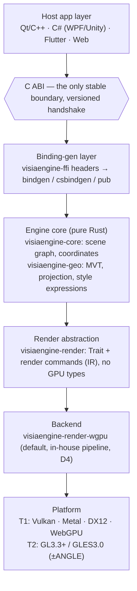
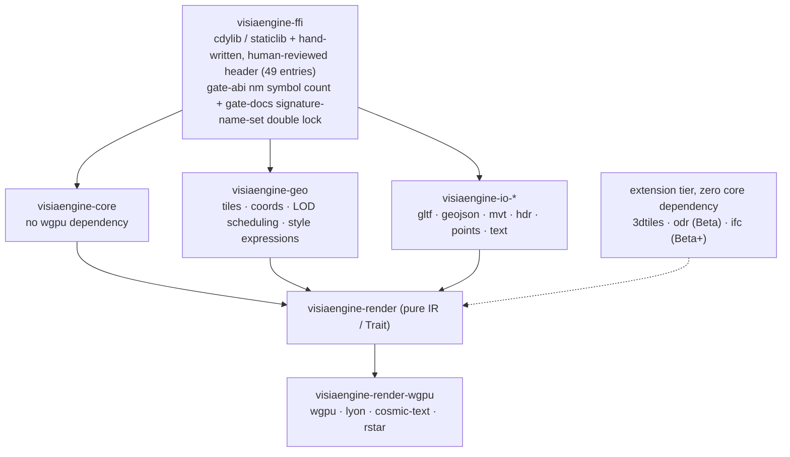
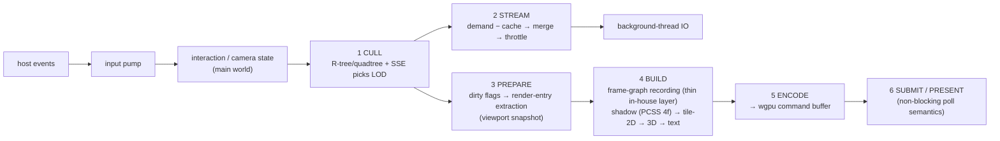
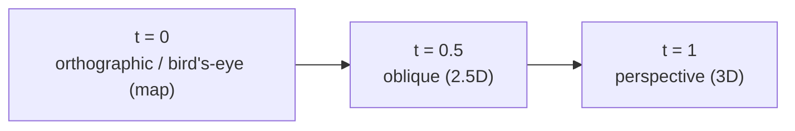
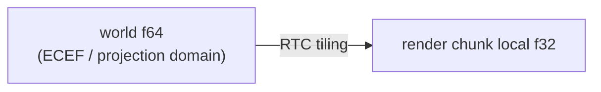
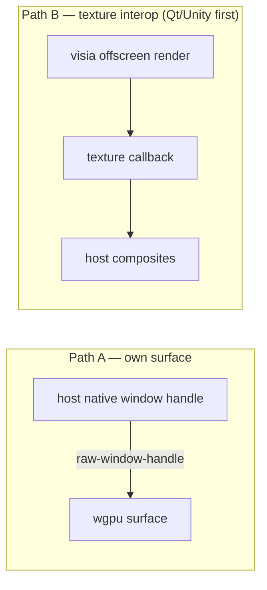
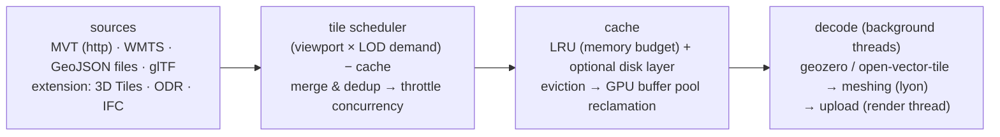
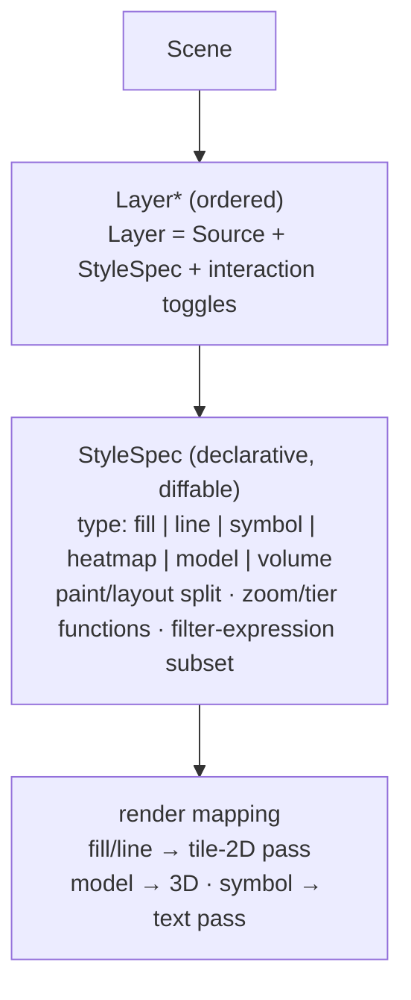

# VisiaEngine Architecture Design

**v0.2 | 2026-09-14** (v0.1 = the 2026-09-03 design baseline) | Inputs: D2 + D4 + the evidence chain (`reference/evidence/` + the 19-file reference-project library)
Status: **batches 0..5 landed** (skeleton/content/geo/interaction/host embedding/wasm/rendering hardening 4ab·4c·4de·4f/docs re-homing). This file = a two-layer design baseline + **landing corrections**: the diagrams are design goals (including unbuilt pieces such as the style/proj split); for the current state read AGENTS.md + `.agents/memorys/status.md`; decision evolution goes through decisions.md (D7-D10 registered).

## Design invariants (outrank every diagram)

1. **`visiaengine-core` never depends on `visiaengine-render`**: the data model runs headless (headless image output/tests/Studio share one source).
2. **The C ABI is the only stable boundary**: wgpu/bevy-grade types stop at `visiaengine-render-wgpu` and never leak beyond the trait (this was the primary reason D4 vetoed Bevy).
3. **One semantic source; backends only add, never fork** (Unity's three-mutually-exclusive-pipelines tuition): no backend may introduce new scene/material semantics.
4. **The main loop belongs to the host**: the engine is only pumped, never builds its own event loop (the rerun spawn/connect model is the reference, the Flutter embedder is the ABI-discipline template).
5. **Compatibility = tier parameterization, not compile-time forking**: capabilities queried at runtime (§ figure ⑥) — capability_query: drawn as design goal, not yet implemented (Alpha tier).
6. **Copyleft dependencies (PROJ/GEOS/OSG family/LGPL pieces) are always feature-gated into the extension layer**, zero contamination in the core package's static link.

## ① Full panoramic layering

## ② Crate dependency directions

Iron rule: dependency arrows point down only; the independence of `visiaengine-geo` — which now owns the style layer (`crates/visiaengine-geo/src/style.rs`) — is the Open Core plugin boundary coded into structure. Splitting style back out into its own crate remains an option, not a current fact.

## ③ One frame's data flow

- **Scene storage settled (converged on this round's Unity-DOTS/UE6 evidence)**: start with slab-handle indexing + dirty flags, **no ECS**; should future performance evidence overturn this, the swap is confined inside `visiaengine-core` and does not break the C ABI.
- **Render-entry IR annotated cluster-ready** (the UE Nanite lesson): the data structures reserve the meshlet/indirect-draw extension slots — unimplemented in MVP, never sealed off.

## ④ 2D/2.5D/3D unification and coordinate precision

The projection is one continuous parameter, not three renderers:
`P = mix(ortho, perspective, t), t ∈ [0, 1]` — what is interpolated are the frustum parameters; one single camera model.

Coordinate precision:

**Ruled (D7, 2026-09-03)**: three layers combined — core f64 global / vertex f32 local (model·tile-level origin) / draw uniform f64 `origin−eye`→f32 (viewer-origin, per frame). Evidence chain `reference/evidence/2026-09-03-rtc-hierarchy.md`; implementation = the GeoJSON slice, glTF's current path stays compatible.

## ⑤ Host embedding model

Thread contract (modeled on the Flutter embedder):

- platform thread = the host's main thread (visia never builds its own event loop, never preempts)
- engine work = an internal task pool (posted via the C API / callbacks)
- render work = driven by the host calling `visiaengine_frame()`; a dedicated render thread is an optional switch
- ABI: first struct fields `{size, api_version}`; export only opaque handles; errors = int code + `visiaengine_last_error()`

## ⑥ Compatibility-tier capability matrix

| Capability | T1 first-class | T2 degraded | T3 Web |
|---|---|---|---|
| API surface | all | all | all |
| compute | yes | GLES3.1+ / missing | yes (WebGPU) / no (WebGL2) |
| indirect | yes | simulated on the GL path | partial |
| shadow / MSAA | full | half | half |
| texture compression | BC / ETC2 / ASTC | per driver | per browser |
Re-validated this round: Godot 4.7 (Vulkan+D3D12+Metal+GL+ANGLE option) and wgpu **independently converged on an isomorphic matrix**; three.js's decade of coexisting WebGL/WebGPU dual renderers proves the "runtime tier selection" route is viable.

## ⑦ Data-source streaming scheduling

Known risks (evidence-backed): the MVT parsing piece is thin (open-vector-tile 10★ -> vendoring allowed); no mature 3D Tiles streaming piece -> **in-house, assigned to Beta**; draco-core is new and thin.

## ⑧ Layer/style model

Open question: spec-compatibility with the MapLibre v8 subset (migration cost traded for ecosystem goodwill) versus a custom design — to be ruled when the style-system design doc is written.

## ⑨ Build/delivery matrix

| Stage | What it produces |
|---|---|
| cargo | `visiaengine-ffi`: cdylib (.dll/.dylib/.so) + staticlib + hand-written, human-reviewed `visiaengine.h` (I0) |
| wasm | the `visiaengine-wasm` standalone crate (CAPI-09 dual-face mirror) has landed; npm packaging = Alpha |
| packaging | vcpkg / NuGet / pub mirrors; size budget core `.so` ≤ 6 MB, total ≤ 10 MB — native cdylib stripped to 7.25 MB, target met (2026-09-24) |
| CI matrix | the full suite runs on T1; T2 spot-checked on LLVMPipe/Mesa software rendering + the Android emulator; WebGL2 in browsers |
| pin discipline | wgpu's quarterly breaks → pin the major version + a per-quarter upgrade window (re-verify all tiers) |

## Open decision points

| # | open question | blast radius | ruling due |
|---|------|--------|--------|
| ~~P1~~ | RTC granularity | — | **✅ ruled by D7 (layered origin)** |
| P2 | style-spec compatibility (MapLibre v8 subset?) | `visiaengine-geo` style layer + migration tooling | at style-system design time |
| P3 | RK3588 driver stack (vendor blob/BSP vs mainline Panvk) | release matrix / QA cost | **business input** (customer persona); does not block code |
| P4 | material expression layer (TSL-style) | rendering long-term | post-MVP, not designed now |

## Kickoff spike checklist

(≤1 day once the toolchain is ready.)

- [ ] bare wgpu triangle vs bevy-minimal three-platform release sizes (fills the evidence data gap, archive-only)
- [ ] frame budget of a 100k-entity slab walk + extract (validates the magnitude of the P0 conservative choice)
- [ ] raw-window-handle into a Qt QWidget minimal demo (figure ⑤ path A feasibility)
- [ ] cosmic-text CJK glyph atlas smoke on GPU (risk R7)
